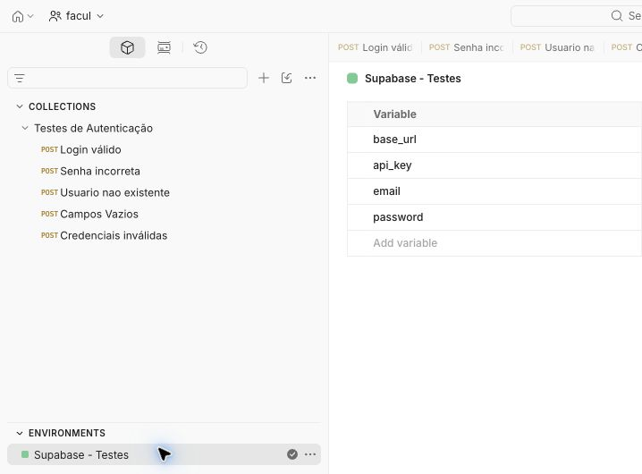
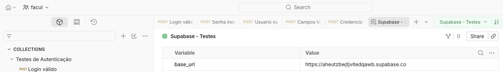
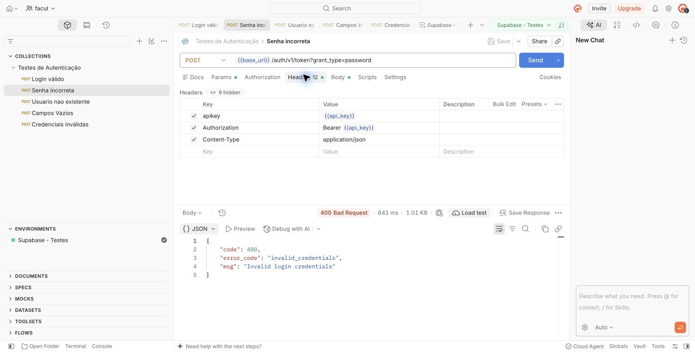
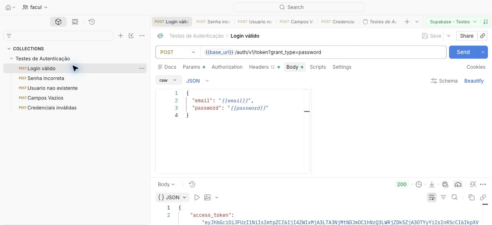
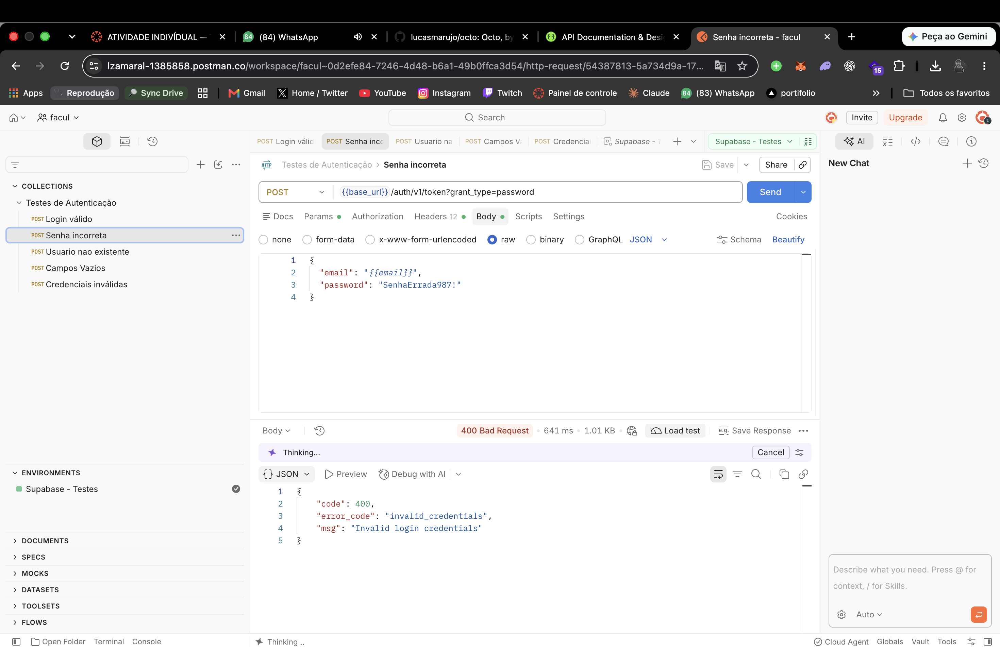
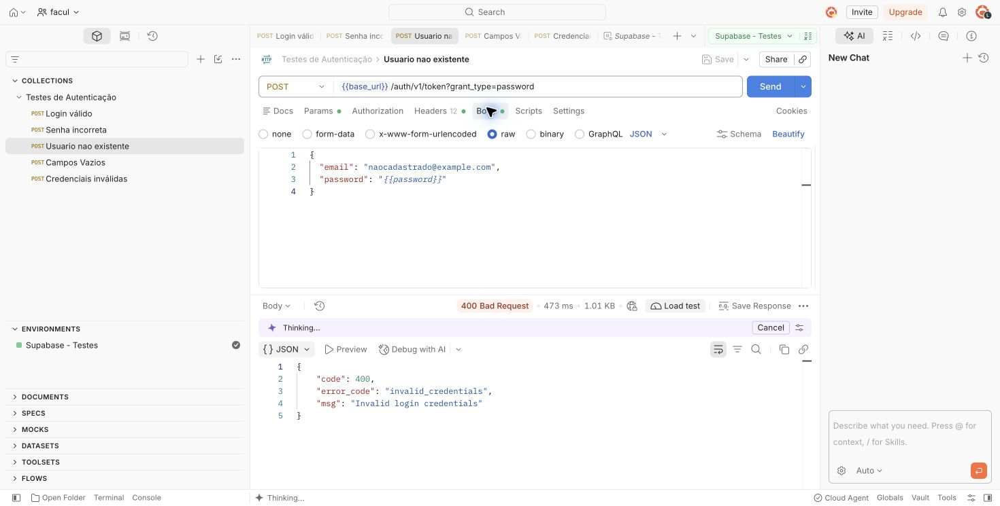
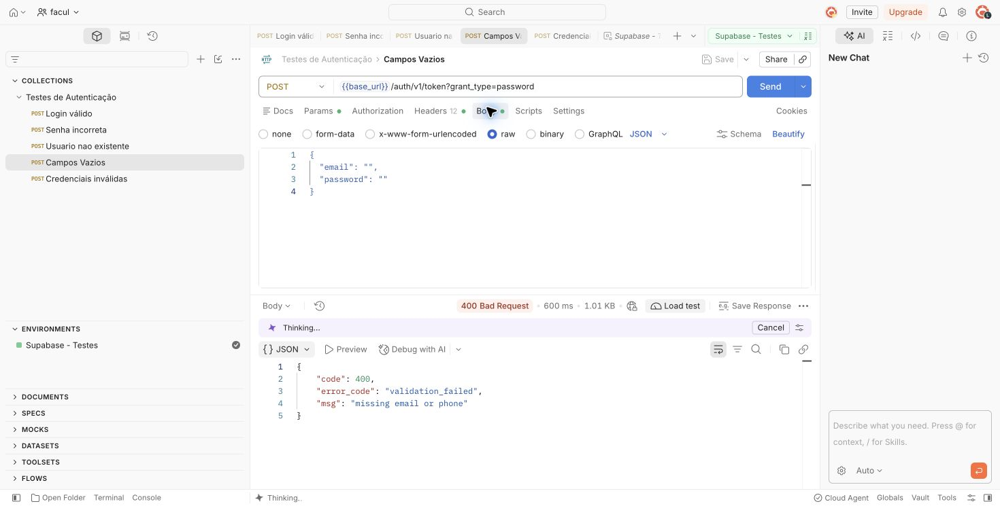
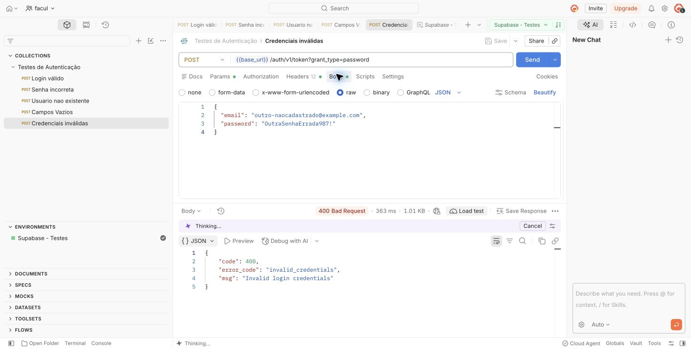
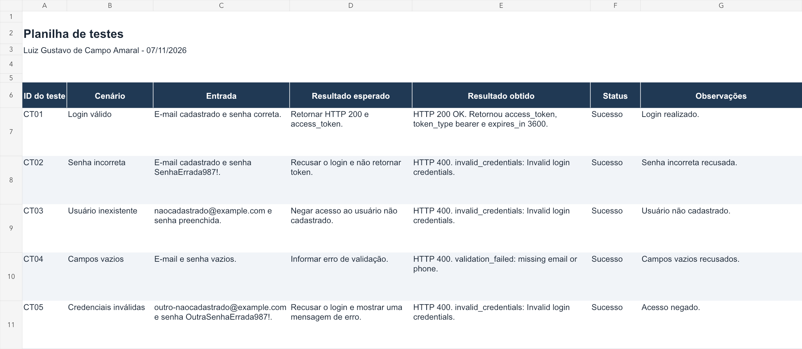

# Introdução

**Aluno:** Luiz Gustavo de Campo Amaral  
**Atividade:** Teste caixa cinza com Supabase e Postman  
**Data da execução:** 07/11/2026

Esta atividade registra testes funcionais da API de autenticação do Supabase. Criei um usuário de teste e enviei requisições HTTP pelo Postman para verificar o login com dados válidos, inválidos e vazios.

A abordagem é de caixa cinza porque os testes utilizam conhecimento do endpoint, dos headers, do corpo JSON e das respostas da API, sem examinar toda a implementação interna do serviço de autenticação. Não foi desenvolvida interface gráfica.

> **Ferramenta utilizada:** os testes documentados foram executados no **Postman Web**, com o Cloud Agent. O enunciado pede **Postman Desktop**; a utilização da versão Web é uma diferença em relação ao requisito e depende da aceitação do professor. Os registros não apresentam uma execução no aplicativo Desktop.

## Organização do repositório

```text
README.md
postman/
  testes-autenticacao.postman_collection.json
  supabase-exemplo.postman_environment.json
prints/
  ct01-login-valido.png
  ct02-senha-incorreta.png
  ct03-usuario-inexistente.png
  ct04-campos-vazios.png
  ct05-credenciais-invalidas.png
  postman-endpoint-headers.png
  postman-workspace-variaveis.png
  postman-ambiente-url.png
  planilha-testes.png
planilha/
  testes.xlsx
  testes.csv
```

As evidências do Postman são capturas das respostas que permaneceram abertas após as execuções do aluno. O enquadramento exclui o painel que exibe a senha e, no login válido, deixa o token completo fora da imagem. Os dados de status HTTP, entradas e mensagens não foram substituídos. O JSON exportado contém as requisições; ele não inclui respostas salvas. Os resultados estão registrados nos prints, neste README e na planilha.

# Objetivo da Atividade

Configurar a autenticação por e-mail e senha, compreender as partes de uma requisição HTTP e verificar como a API responde aos cinco cenários exigidos. A documentação permite comparar o resultado esperado com o comportamento observado e localizar a evidência de cada execução.

# Configuração do Supabase

O projeto foi criado no painel do Supabase, na organização `Facul`, com o nome `Atividade_Ohata_Luiz-Amaral`. Esse nome identifica o aluno no ambiente. No menu **Authentication → Sign In / Providers**, o provedor **Email** estava habilitado, e a opção **Confirm email** estava ligada.

Um usuário foi criado em **Authentication → Users**, com e-mail e senha próprios para os testes. O endereço cadastrado é utilizado pela variável `email`; a senha é mantida na variável `password`. A senha do usuário de autenticação é diferente da senha do banco de dados do projeto. O login válido confirmou que as credenciais do usuário estavam utilizáveis.

**URL da API:** `https://aheutzbwjtjvitedqawb.supabase.co`

A URL foi obtida em **Connect**, no valor de `NEXT_PUBLIC_SUPABASE_URL`. A chave utilizada foi a **anon legada**, localizada em **Settings → API Keys → View legacy API keys**. Ela foi armazenada em `api_key`. Não foi utilizada chave `service_role` nem chave secreta administrativa.

A configuração teve como objetivo disponibilizar um serviço real de autenticação para os testes HTTP. A chave `anon` identifica o acesso ao projeto; o e-mail e a senha identificam o usuário que solicita uma sessão.

**Evidências desta etapa:** o projeto, o usuário, o provedor habilitado e a tela de chaves foram apresentados durante a atividade. Os arquivos originais desses prints ainda precisam ser adicionados à pasta `prints/` e incorporados aqui. As evidências do Postman e da planilha já acompanham esta versão.

# Configuração do Postman

Foi utilizado o Workspace `facul`. As cinco requisições foram organizadas na coleção **Testes de Autenticação**. O Environment **Supabase - Testes** reúne os valores reutilizados nas chamadas e foi selecionado no topo do Postman antes dos envios.

| Variável | Finalidade | Valor na entrega pública |
| --- | --- | --- |
| `base_url` | Endereço base da API do projeto | URL do projeto |
| `api_key` | Chave anon legada enviada nos headers | Omitido; preencher no ambiente local |
| `email` | E-mail do usuário cadastrado para o teste válido | Omitido; preencher no ambiente local |
| `password` | Senha do usuário de autenticação | Omitido; preencher no ambiente local |

As variáveis são referenciadas com duas chaves, como `{{base_url}}`. No Environment, as alterações são salvas automaticamente. As requisições foram salvas após sua configuração. O Postman foi usado para editar as entradas, enviar cada chamada e inspecionar manualmente o status HTTP e o JSON retornado.





## Como importar a coleção

1. Importe [a coleção](postman/testes-autenticacao.postman_collection.json) e [o modelo de ambiente](postman/supabase-exemplo.postman_environment.json) no Postman.
2. No ambiente importado, preencha `api_key` com a chave anon legada do projeto, `email` e `password` com o usuário de teste. Se utilizar outro projeto, atualize `base_url`.
3. Selecione o ambiente no topo da aplicação.
4. Confira que os e-mails utilizados como inexistentes realmente não estão cadastrados no projeto escolhido.
5. Abra cada requisição, confira os headers e o corpo JSON e envie individualmente.
6. Compare o comportamento com a tabela de cenários. O código HTTP documentado abaixo é o observado nesta execução.

O modelo não contém senha, chave nem token de sessão. A coleção usa a chave anon legada como Bearer. Uma chave nova `sb_publishable_` não deve ser colocada como token Bearer; a configuração precisa ser adaptada ao trocar o tipo de chave.

# Configuração das Requisições

**Método HTTP:** `POST`  
**Endpoint:** `/auth/v1/token?grant_type=password`  
**URL no Postman:** `{{base_url}}/auth/v1/token?grant_type=password`

O método POST envia os dados de login no corpo da requisição. O parâmetro `grant_type=password` seleciona a autenticação por senha. A finalidade da chamada é solicitar uma sessão para o usuário informado.

## Headers

| Header | Valor utilizado | Função |
| --- | --- | --- |
| `apikey` | `{{api_key}}` — valor real omitido (`XXXXX`) | Identifica o projeto pelo acesso da aplicação |
| `Authorization` | `Bearer {{api_key}}` | Envia a chave anon legada no formato Bearer |
| `Content-Type` | `application/json` | Indica que o corpo está em JSON |

A aba Authorization foi configurada como **No Auth** para permitir o preenchimento manual do header `Authorization`, sem gerar outro header automaticamente.



## Body JSON do login válido

Configurado em **Body → raw → JSON**:

```json
{
  "email": "{{email}}",
  "password": "{{password}}"
}
```

O e-mail e a senha são substituídos pelos valores do Environment no envio. Os exemplos de senhas incorretas apresentados nos demais testes são entradas propositalmente inválidas.

# Execução dos Testes

Os cinco cenários foram executados manualmente pelo aluno. Em cada resposta, foram verificados o status HTTP, o conteúdo JSON, a mensagem ou código de erro e a presença ou ausência de `access_token`.

## Tabela de cenários

| ID | Cenário | Entrada utilizada | Resultado esperado | Resultado obtido | Status |
| --- | --- | --- | --- | --- | --- |
| CT01 | Login válido | E-mail cadastrado e senha correta | HTTP 200 e access_token | HTTP 200 OK e access_token preenchido | Sucesso |
| CT02 | Senha incorreta | E-mail cadastrado e senha incorreta | Rejeitar login sem token | HTTP 400; invalid_credentials | Sucesso |
| CT03 | Usuário inexistente | E-mail não cadastrado e senha preenchida | Negar acesso sem token | HTTP 400; invalid_credentials | Sucesso |
| CT04 | Campos vazios | E-mail e senha vazios | Erro de validação sem token | HTTP 400; validation_failed | Sucesso |
| CT05 | Credenciais inválidas | E-mail não cadastrado e senha incorreta | Mensagem de erro sem token | HTTP 400; invalid_credentials | Sucesso |

**Critério de status:** “Sucesso” significa que o comportamento observado correspondeu ao esperado. Nos cenários negativos, a rejeição do login é o resultado correto do teste.

## CT01 — Login válido

Entrada: `email = {{email}}` e `password = {{password}}`.

Resultado observado: **HTTP 200 OK**, campo `access_token` preenchido, `token_type` igual a `bearer` e `expires_in` igual a `3600`. A API criou uma sessão. O valor completo do token não acompanha a documentação pública.



## CT02 — Senha incorreta

```json
{
  "email": "{{email}}",
  "password": "SenhaErrada987!"
}
```

Resultado observado: **HTTP 400 Bad Request**, sem `access_token`:

```json
{
  "code": 400,
  "error_code": "invalid_credentials",
  "msg": "Invalid login credentials"
}
```



## CT03 — Usuário inexistente

```json
{
  "email": "naocadastrado@example.com",
  "password": "{{password}}"
}
```

Resultado observado: **HTTP 400 Bad Request**, `error_code` igual a `invalid_credentials`, mensagem `Invalid login credentials` e ausência de `access_token`.



## CT04 — Campos vazios

```json
{
  "email": "",
  "password": ""
}
```

Resultado observado: **HTTP 400 Bad Request**, sem `access_token`:

```json
{
  "code": 400,
  "error_code": "validation_failed",
  "msg": "missing email or phone"
}
```

A mensagem identifica a ausência de e-mail ou telefone. Essa resposta evidencia a rejeição dessa entrada vazia; o cenário não isola, sozinho, a validação do campo senha.



## CT05 — Credenciais inválidas

```json
{
  "email": "outro-naocadastrado@example.com",
  "password": "OutraSenhaErrada987!"
}
```

Resultado observado: **HTTP 400 Bad Request**, `error_code` igual a `invalid_credentials`, mensagem `Invalid login credentials` e ausência de `access_token`. Neste cenário foram usados, ao mesmo tempo, um e-mail inexistente e uma senha diferente da válida.



## Dificuldade durante a configuração

Uma tentativa inicial retornou **HTTP 401 Unauthorized**, com `No API key found in request` e a indicação de ausência do header `apikey`. Nessa tentativa, o método também ainda estava como GET. A configuração foi corrigida para POST, com os headers exigidos e o body JSON. Em seguida, o login válido retornou HTTP 200.

Esse episódio foi um erro de configuração da requisição. Ele não é contado como um dos cinco cenários finais e não comprova um defeito no Supabase. As sugestões automáticas do Postman para corrigir senhas foram desconsideradas nos testes negativos, pois as entradas inválidas eram intencionais.

# Registro dos Testes

Os registros estão na [planilha Excel](planilha/testes.xlsx) e em uma [cópia CSV](planilha/testes.csv). Cada linha contém ID do teste, cenário, entrada, resultado esperado, resultado obtido, status e observações. A coluna de observações indica a evidência correspondente em `prints/`.



Por exemplo, o CT02 foi registrado como sucesso porque a senha incorreta gerou HTTP 400 e `invalid_credentials`, sem liberar uma sessão. O CT04 também teve sucesso, pois a API recusou os campos vazios com `validation_failed`.

O registro facilita a revisão dos dados enviados, evita confundir erro HTTP esperado com falha de teste e permite comparar novas execuções com o comportamento observado. Não foram identificadas falhas funcionais nos cinco cenários finais. A dificuldade identificada foi a configuração incompleta da requisição inicial.

# Resultados Obtidos

Os **cinco cenários** apresentaram o comportamento esperado: o login válido retornou uma sessão, e os outros quatro não retornaram token de acesso. Nos testes de senha incorreta, usuário inexistente e par inválido, a resposta foi a mesma mensagem genérica de credenciais inválidas.

Os testes cobrem somente os cenários descritos. Não foram testados expiração e renovação de token, logout, bloqueio por tentativas, permissões de dados ou desempenho. A presença de `access_token` foi verificada no JSON; sua validade para acessar outro endpoint não foi testada nesta atividade.

O resultado funcional dos testes foi satisfatório. A entrega ainda precisa incorporar as evidências do painel Supabase e atender à exigência de ferramenta do enunciado: as execuções registradas são da versão Web, e não do aplicativo Desktop.

# Conclusão

Consegui configurar a autenticação e executar os cinco cenários de teste. Com e-mail e senha corretos, o Supabase retornou HTTP 200 e um token de acesso. As entradas incorretas foram rejeitadas com HTTP 400, e os campos vazios geraram uma mensagem de validação.

A principal dificuldade foi entender a diferença entre configurar variáveis e realmente enviá-las nos headers e no corpo da requisição. Na primeira tentativa faltou o header apikey, e o método ainda precisava ser alterado para POST. Após esses ajustes, foi possível obter o login válido e comparar os demais resultados.

Não identifiquei defeitos funcionais nos cenários realizados. Como melhoria, seria útil acrescentar testes separados para apenas e-mail vazio e apenas senha vazia, além de verificar expiração, renovação e uso do token em uma rota protegida. As validações também poderiam ser automatizadas no Postman em uma etapa futura; os testes desta entrega foram manuais.

Os testes de caixa cinza ajudaram a relacionar o que foi enviado com o que a API retornou. Conhecer a estrutura da chamada permitiu corrigir a configuração inicial e distinguir uma rejeição esperada de um comportamento incorreto.

A documentação foi organizada em repositório público no GitHub. Para concluir a entrega conforme o enunciado, ainda é necessário adicionar as evidências do Supabase e resolver a diferença entre Postman Web e Desktop.

## Referências

- [Supabase: autenticação por senha](https://supabase.com/docs/guides/auth/passwords)
- [Supabase: tipos de chave da API](https://supabase.com/docs/guides/getting-started/api-keys)
- [Postman: variáveis de ambiente](https://learning.postman.com/docs/use/send-requests/variables/environment-variables)
