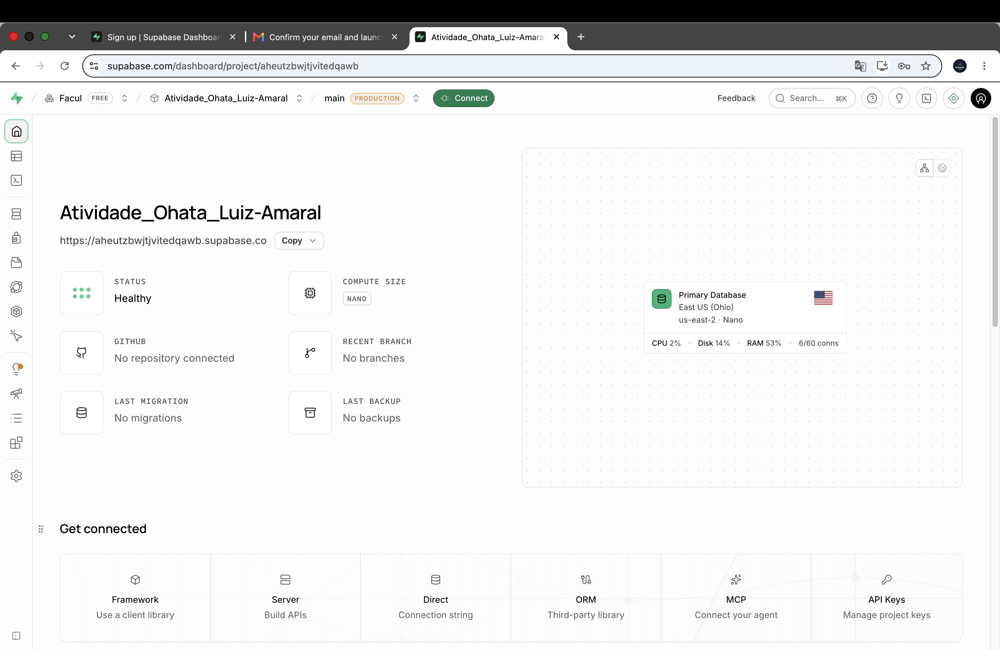

# Introdução

Aluno: Luiz Gustavo de Campo Amaral  
Data: 07/11/2026

Nesta atividade, configurei um projeto no Supabase e usei o Postman para testar o login por e-mail e senha. Fiz os testes diretamente na API, sem criar uma interface.

O teste é de caixa cinza porque eu conhecia o endpoint, os headers e o formato dos dados enviados, mas não tinha acesso à implementação interna da autenticação.

# Objetivo da Atividade

Verificar se a API permite o login com os dados corretos e recusa as tentativas com senha errada, usuário inexistente, campos vazios e credenciais inválidas. Também registrei as respostas e os prints de cada teste.

# Configuração do Supabase

Criei o projeto `Atividade_Ohata_Luiz-Amaral`, na organização `Facul`. Configurei a autenticação por e-mail e senha e cadastrei um usuário em Authentication > Users para fazer os testes.

O provedor Email estava habilitado em Sign In / Providers. Depois, copiei a URL do projeto e a chave `anon`, disponível em API Keys > View legacy API keys. Guardei esses valores para usar no Postman.

URL do projeto:

```text
https://aheutzbwjtjvitedqawb.supabase.co
```

Essa configuração permitiu testar o login em um ambiente real. O nome do projeto também identifica o aluno responsável pela atividade.



# Configuração do Postman

Usei o Postman Web no Workspace `facul`. Criei a coleção `Testes de Autenticação` e o ambiente `Supabase - Testes`.

No ambiente, configurei as seguintes variáveis:

| Variável | Finalidade |
| --- | --- |
| `base_url` | URL do projeto Supabase |
| `api_key` | Chave anon do projeto |
| `email` | E-mail do usuário cadastrado |
| `password` | Senha do usuário de teste |

Selecionei esse ambiente antes de enviar as requisições. Assim, pude usar `{{email}}` e `{{password}}` sem repetir os dados em cada chamada. A senha utilizada foi a do usuário de autenticação, e não a senha do banco de dados.

Os arquivos estão na pasta [postman](postman/). A coleção pode ser importada no Postman junto com o modelo de ambiente. Os valores de e-mail, senha e chave devem ser preenchidos na cópia local do ambiente.

# Configuração das Requisições

Configurei uma requisição POST para o endpoint:

```text
{{base_url}}/auth/v1/token?grant_type=password
```

Essa requisição envia o e-mail e a senha para solicitar uma sessão de login.

Utilizei estes headers:

| Header | Valor |
| --- | --- |
| `apikey` | `{{api_key}}` |
| `Authorization` | `Bearer {{api_key}}` |
| `Content-Type` | `application/json` |

O valor real da chave foi omitido da documentação. A configuração usa a chave anon legada.

Em Body, selecionei raw e JSON. Para o login válido, enviei:

```json
{
  "email": "{{email}}",
  "password": "{{password}}"
}
```

Dupliquei a requisição para os outros cenários, mantendo a URL e os headers e alterando os dados do Body.

# Execução dos Testes

Executei os cinco cenários abaixo. Em cada um, conferi o status HTTP, a resposta JSON, a mensagem de erro e se foi retornado um access_token.

| ID | Cenário | Entrada utilizada | Resultado esperado | Resultado obtido | Status |
| --- | --- | --- | --- | --- | --- |
| CT01 | Login válido | E-mail cadastrado e senha correta | HTTP 200 e token de acesso | HTTP 200 e access_token retornado | Sucesso |
| CT02 | Senha incorreta | E-mail cadastrado e senha errada | Login recusado, sem token | HTTP 400, invalid_credentials | Sucesso |
| CT03 | Usuário inexistente | E-mail não cadastrado e senha preenchida | Acesso negado | HTTP 400, invalid_credentials | Sucesso |
| CT04 | Campos vazios | E-mail e senha vazios | Erro de validação | HTTP 400, validation_failed | Sucesso |
| CT05 | Credenciais inválidas | E-mail não cadastrado e senha errada | Mensagem de erro | HTTP 400, invalid_credentials | Sucesso |

## CT01: login válido

Com os dados corretos, recebi HTTP 200 OK. A resposta trouxe `access_token`, `token_type` com o valor `bearer` e `expires_in` igual a `3600`.

Os valores dos tokens foram ocultados no print.


## CT02: senha incorreta

Mantive o e-mail cadastrado e troquei a senha por `SenhaErrada987!`. A API retornou HTTP 400, com o código `invalid_credentials` e a mensagem `Invalid login credentials`.


## CT03: usuário inexistente

Usei o e-mail `naocadastrado@example.com`, que não estava cadastrado no projeto. O resultado foi HTTP 400, com `invalid_credentials` e a mensagem `Invalid login credentials`.


## CT04: campos vazios

Enviei os dois campos sem nenhum valor:

```json
{
  "email": "",
  "password": ""
}
```

A API retornou HTTP 400, com o código `validation_failed` e a mensagem `missing email or phone`.


## CT05: credenciais inválidas

Usei `outro-naocadastrado@example.com` e a senha `OutraSenhaErrada987!`. A resposta foi HTTP 400, com `invalid_credentials` e a mensagem `Invalid login credentials`.


# Registro dos Testes

Registrei os testes em uma [planilha Excel](planilha/testes.xlsx), com ID, cenário, entrada, resultado esperado, resultado obtido, status e observações. Também deixei uma [cópia em CSV](planilha/testes.csv).

Esse registro ajuda a comparar as respostas e consultar depois quais dados foram usados em cada tentativa. Não encontrei falhas de autenticação nos cinco cenários executados.


# Resultados Obtidos

O login com os dados corretos retornou HTTP 200 e um token de acesso. Os outros quatro testes foram recusados com HTTP 400, sem retornar access_token.

Senha incorreta, usuário inexistente e credenciais inválidas receberam a mesma mensagem: `Invalid login credentials`. Já os campos vazios retornaram `missing email or phone`.

No começo, uma tentativa retornou HTTP 401 com a mensagem `No API key found in request`. Eu ainda precisava incluir o header `apikey` e trocar o método de GET para POST. Depois que corrigi a requisição, o login funcionou.

# Conclusão

Consegui executar os cinco testes e obter as respostas esperadas. A autenticação funcionou com o usuário e a senha corretos e bloqueou as entradas inválidas.

Minha maior dificuldade foi configurar a primeira requisição no Postman, principalmente os headers e o método HTTP. Depois disso, usei cópias da requisição para testar as outras situações.

Não identifiquei falhas nos cenários realizados. Para ampliar os testes, eu poderia verificar a expiração do token e testar o e-mail vazio e a senha vazia separadamente.

A atividade me ajudou a entender como uma API de autenticação recebe os dados e responde às tentativas de login. Conhecer parte da estrutura da requisição foi importante para encontrar o erro de configuração e conferir o comportamento da API.
